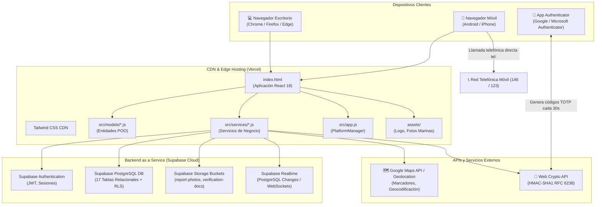

# 🏗️ Diagrama de Arquitectura del Sistema - Vida Marina ODS 14
**Universidad Manuela Beltrán — Ingeniería de Software**  
**Sprints 1, 2 y 3 Integrados (Arquitectura por Capas y BaaS)**

---

## 1. Enfoque Arquitectónico

La plataforma **Vida Marina** implementa una **Arquitectura en Capas (Layered / N-Tier Architecture)** acoplada a un modelo **BaaS (Backend as a Service)** mediante **Supabase**, con un motor resiliente de persistencia dual:

```
┌────────────────────────────────────────────────────────────────────────┐
│                   CAPA DE PRESENTACIÓN / VISTA (UI)                    │
│      React 18 + Tailwind CSS + Plus Jakarta Sans + Canvas Confetti     │
│   (Inicio, Mapa RF05, Emergencias RF06, Admin RF09, Acreditación RF10)  │
└───────────────────────────────────┬────────────────────────────────────┘
                                    │ Invoca métodos del controlador
                                    ▼
┌────────────────────────────────────────────────────────────────────────┐
│                   CAPA CONTROLADORA (CONTROLLER LAYER)                 │
│                              PlatformManager                           │
│       (Orquesta el flujo de negocio, eventos y actualización de UI)    │
└───────────────┬────────────────────────────────────────┬───────────────┘
                │ Coordina                               │ Hidrata / Manipula
                ▼                                        ▼
┌──────────────────────────────────────┐  ┌──────────────────────────────┐
│       CAPA DE SERVICIOS (SERVICES)   │  │   MODELOS DE DOMINIO (POO)   │
│  * AuthenticationService (2FA TOTP)  │  │  * User (4 Subclases RBAC)   │
│  * TotpService (RFC 6238 HMAC-SHA1)  │  │  * EnvironmentalReport (RF05)│
│  * ReportService (RF05)              │  │  * EmergencyContact (RF06)   │
│  * VerificationService (RF10)        │  │  * ExpertVerification (RF10) │
│  * EmergencyContactService (RF06)    │  │  * Activity & Badge          │
│  * GoogleMapsService (GPS / Geocod)  │  │  * ForumPost & Comment       │
│  * SupabaseService (Cliente BaaS)    │  │  * DonationCampaign          │
│  * DatabaseService (Singleton)       │  │  * Notification & AuditLog   │
└──────────────────┬───────────────────┘  └──────────────────────────────┘
                   │
                   ▼
┌────────────────────────────────────────────────────────────────────────┐
│                CAPA DE PERSISTENCIA DUAL (DUAL ENGINE)                 │
│                                                                        │
│   ┌─────────────────────────────────┐   ┌───────────────────────────┐  │
│   │        SUPABASE EN LA NUBE      │   │  LOCALSTORAGE / CACHÉ     │  │
│   │ * PostgreSQL Relacional (Tablas)│   │ * Persistencia local      │  │
│   │ * Supabase Storage (Fotos, PDFs)│   │ * Ejecución Standalone    │  │
│   │ * Row Level Security (RLS)      │   │ * Cero configuración      │  │
│   │ * Supabase Realtime (WebSockets)│   │ * Modo offline/resiliente │  │
│   └─────────────────────────────────┘   └───────────────────────────┘  │
└────────────────────────────────────────────────────────────────────────┘
```

---

## 2. Diagrama de Arquitectura de Despliegue y Flujo de Datos (Mermaid)



---

## 3. Principios de Diseño y Patrones Aplicados

1. **Separación de Responsabilidades (SoC):** Cada clase y módulo atiende una función exclusiva: los modelos encapsulan estado y reglas de negocio; los servicios gestionan conexiones y cálculos externos; el controlador orquesta la lógica de la aplicación; y la vista React renderiza la interfaz.
2. **Patrón Singleton:** `DatabaseService` y `SupabaseService` garantizan una única instancia compartida durante todo el ciclo de vida de la aplicación, evitando condiciones de carrera en la memoria.
3. **Patrón Factory:** `UserFactory.createUser(data)` analiza el rol del usuario e instancia automáticamente la subclase polimórfica adecuada (`AdminCoordinator`, `ExpertResearcher`, `Volunteer` o `Citizen`).
4. **Resiliencia y Modo Híbrido (Graceful Degradation):** Si la conexión a Supabase no está configurada o se encuentra sin red, el sistema cambia automáticamente al motor local en `localStorage` sin interrumpir la experiencia del usuario ni generar pantallas en blanco.
