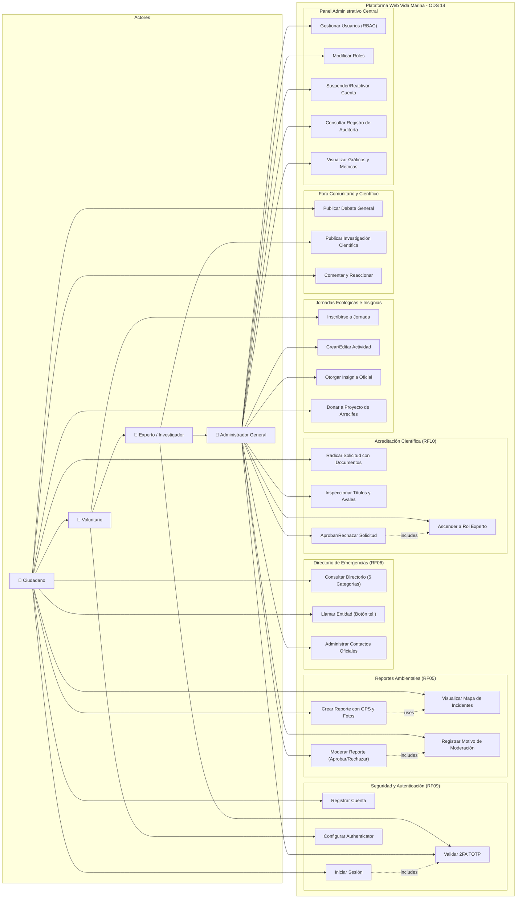

# 🎯 Diagrama de Casos de Uso - Plataforma Vida Marina ODS 14
**Universidad Manuela Beltrán — Ingeniería de Software**  
**Sprints 1, 2 y 3 Integrados (Modelo de Casos de Uso)**

---

## 1. Actores del Sistema

1. **Ciudadano:** Actor inicial sin requisitos previos. Puede consultar contenidos, explorar emergencias, registrar incidentes ambientales geolocalizados y radicar su expediente para ascender a Experto.
2. **Voluntario:** Actor comunitario activo. Además de los permisos de Ciudadano, puede inscribirse a jornadas ecológicas, acumular puntos (XP), subir de nivel y obtener insignias oficiales.
3. **Experto o Investigador:** Científico o representante de ONG acreditado formalmente con segundo factor de autenticación (2FA). Puede publicar investigaciones en el foro científico, analizar reportes ambientales aprobados y participar en jornadas avanzadas.
4. **Administrador General:** Máxima autoridad directiva con 2FA obligatorio. Controla el panel administrativo (RBAC), modera reportes e investigaciones, gestiona usuarios y contactos de emergencia, otorga insignias y revisa el registro de auditoría.
5. **Servicios Externos:** Google Maps API (geolocalización y geocodificación), Supabase BaaS (PostgreSQL, Storage, Realtime) y Aplicaciones TOTP (Google/Microsoft Authenticator).

---

## 2. Diagrama de Casos de Uso (Mermaid)

---

## 3. Especificación Detallada de Casos de Uso Principales

### CU-05: Realizar Reporte Ambiental Geolocalizado (RF05)
* **Actor Principal:** Ciudadano / Voluntario / Experto.
* **Precondiciones:** Usuario autenticado con sesión activa.
* **Flujo Principal:**
  1. El usuario accede a la sección *"Reportes Ambientales"*.
  2. Presiona el botón *"Nuevo Reporte Ambiental"*.
  3. Selecciona la categoría del incidente (Vertimiento, Pesca ilegal, Derrame, Plásticos u Otros).
  4. Ingresa una descripción detallada de lo observado.
  5. Presiona *"📍 Usar mi GPS Actual"* (el navegador solicita permisos y fija latitud y longitud).
  6. Adjunta fotografías de evidencia visual (URLs o subida).
  7. Presiona *"Enviar Reporte a Revisión"*.
  8. El sistema guarda el reporte en estado `pendiente` y suma +30 XP al perfil del usuario.
* **Postcondiciones:** El reporte no es visible para el público general hasta su aprobación administrativa.

### CU-06: Consultar Directorio de Emergencias y Llamada Rápida (RF06)
* **Actor Principal:** Cualquier visitante, Ciudadano, Voluntario o Administrador.
* **Precondiciones:** Ninguna (acceso público y directo desde el navbar o home).
* **Flujo Principal:**
  1. El usuario hace clic en el botón de alerta *"Emergencias"* o en el banner superior.
  2. El sistema despliega el directorio clasificado en 6 categorías con entidades colombianas verificadas.
  3. El usuario puede filtrar por categoría (Guardacostas, Líneas Directas, CARs, etc.) o buscar por nombre/ciudad.
  4. Al presionar el botón verde *"Llamar: [Teléfono]"*, el dispositivo móvil o cliente de telefonía activa el protocolo `tel:` para llamada inmediata.

### CU-09: Control de Acceso por Roles (RBAC) y Desafío 2FA (RF09)
* **Actor Principal:** Administrador General / Experto.
* **Flujo Principal:**
  1. El usuario ingresa correo y contraseña.
  2. El sistema valida las credenciales y detecta si el usuario tiene rol que exige 2FA o lo tiene activo.
  3. El sistema solicita el código dinámico de 6 dígitos (TOTP RFC 6238).
  4. El usuario abre su app móvil (Google / Microsoft Authenticator) e ingresa el código.
  5. El servicio `TotpService` verifica el código contra la clave secreta Base32 dentro de la ventana de tiempo.
  6. Si es correcto, el sistema otorga la sesión y carga los privilegios del rol correspondiente.

### CU-10: Verificación de Expediente de Experto e Investigador (RF10)
* **Actor Principal:** Ciudadano (solicitante) y Administrador (revisor).
* **Flujo Principal:**
  1. El Ciudadano completa el formulario de solicitud indicando institución de respaldo, especialidad y adjuntando archivos (PDF/JPG).
  2. La solicitud queda en estado `pendiente`.
  3. El Administrador abre el panel *"Solicitudes de Expertos"*, inspecciona los documentos y registra observaciones.
  4. Al presionar *"Aprobar"*, el sistema notifica al usuario que debe configurar su 2FA para completar su ascenso formal al rol de `Experto`.
