# 🏛️ Diagrama de Clases UML - Plataforma Vida Marina ODS 14
**Universidad Manuela Beltrán — Ingeniería de Software**  
**Sprints 1, 2 y 3 Integrados (Arquitectura POO Completa)**

---

## 1. Descripción de la Arquitectura Orientada a Objetos

El diseño de la plataforma aplica formalmente los cuatro pilares de la Programación Orientada a Objetos (POO):
1. **Abstracción:** Entidades centrales del mundo real de la conservación marina modeladas con propiedades y métodos específicos.
2. **Encapsulamiento:** Protección de datos sensibles (contraseñas, secretos 2FA), mutadores controlados (`addXP`, `enrollInActivity`, `approve`, `reject`).
3. **Herencia:** Jerarquía clara donde la clase base `User` se especializa en cuatro roles: `Citizen`, `Volunteer`, `ExpertResearcher` y `AdminCoordinator`.
4. **Polimorfismo:** Sobreescritura de métodos de control de acceso (`canModerate`, `canPublishScience`, `canEnrollActivities`, `canReviewReports`, `getRoleBadgeColor`, `getRoleTitle`, `calculateEcologicalImpact`).

---

## 2. Diagrama de Clases UML (Mermaid)

```mermaid
classDiagram
    direction TB

    %% Jerarquía de Usuarios (Herencia y Polimorfismo)
    class User {
        +String id
        +String name
        +String email
        -String password
        +String city
        +String avatar
        +String role
        +Number level
        +Number xp
        +Array enrolledActivityIds
        +Array earnedBadgeIds
        -String twoFactorSecret
        +Boolean twoFactorEnabled
        +String status
        +String institution
        +String specialization
        +DateTime verifiedAt
        +DateTime createdAt
        +validatePassword(plainPassword) Boolean
        +setPassword(newPassword) Boolean
        +addXP(points) Number
        +calculateLevel() Number
        +enrollInActivity(activityId) Boolean
        +cancelActivityEnrollment(activityId) Boolean
        +isEnrolledIn(activityId) Boolean
        +hasBadge(badgeId) Boolean
        +awardBadge(badgeId) Boolean
        +revokeBadge(badgeId) Boolean
        +enable2FA(secret) Boolean
        +disable2FA() void
        +has2FA() Boolean
        +requires2FA() Boolean
        +isActive() Boolean
        +isSuspended() Boolean
        +suspend() void
        +reactivate() void
        +canModerate()* Boolean
        +canPublishScience()* Boolean
        +canEnrollActivities()* Boolean
        +canReviewReports()* Boolean
        +canManageDirectory()* Boolean
        +getRoleBadgeColor()* String
        +getRoleTitle()* String
        +calculateEcologicalImpact()* Object
        +toJSON() Object
    }

    class Citizen {
        +canModerate() Boolean
        +canPublishScience() Boolean
        +canEnrollActivities() Boolean
        +getRoleBadgeColor() String
        +getRoleTitle() String
    }

    class Volunteer {
        +canModerate() Boolean
        +canPublishScience() Boolean
        +canEnrollActivities() Boolean
        +getRoleBadgeColor() String
        +getRoleTitle() String
        +calculateEcologicalImpact() Object
    }

    class ExpertResearcher {
        +String institution
        +String specialization
        +DateTime verifiedAt
        +canModerate() Boolean
        +canPublishScience() Boolean
        +canEnrollActivities() Boolean
        +getRoleBadgeColor() String
        +getRoleTitle() String
    }

    class AdminCoordinator {
        +String department
        +canModerate() Boolean
        +canPublishScience() Boolean
        +canEnrollActivities() Boolean
        +canReviewReports() Boolean
        +canManageDirectory() Boolean
        +getRoleBadgeColor() String
        +getRoleTitle() String
    }

    User <|-- Citizen : Herencia
    User <|-- Volunteer : Herencia
    User <|-- ExpertResearcher : Herencia
    User <|-- AdminCoordinator : Herencia

    %% Entidades de Negocio
    class Activity {
        +String id
        +String name
        +String description
        +String image
        +Date date
        +String time
        +String location
        +String responsible
        +String type
        +Number totalSpots
        +Number enrolledCount
        +Array enrolledUserIds
        +Array requirements
        +hasAvailableSpots() Boolean
        +getAvailableSpots() Number
        +isUserEnrolled(userId) Boolean
        +enrollUser(userId) Boolean
        +cancelUserEnrollment(userId) Boolean
        +updateDetails(data) void
        +toJSON() Object
    }

    class Badge {
        +String id
        +String icon
        +String name
        +String description
        +String requirement
        +String earnedAt
        +isEarnedBy(user) Boolean
        +awardTo(user, granterName) Boolean
        +revokeFrom(user) Boolean
        +toJSON() Object
    }

    class EnvironmentalReport {
        +String id
        +String reporterId
        +String reporterName
        +String reporterEmail
        +String reporterRole
        +String incidentType
        +String description
        +Date date
        +Number latitude
        +Number longitude
        +String address
        +Array photos
        +String status
        +String moderationNotes
        +String moderatedBy
        +DateTime moderatedAt
        +DateTime createdAt
        +approve(adminName, notes) Boolean
        +reject(adminName, reason) Boolean
        +isApproved() Boolean
        +isPending() Boolean
        +isRejected() Boolean
        +addPhoto(photoUrl) Boolean
        +getIncidentLabel() String
        +getIncidentBadgeColor() String
        +getStatusBadge() Object
        +toJSON() Object
    }

    class EmergencyContact {
        +String id
        +String name
        +String category
        +String phone
        +String email
        +String website
        +String location
        +String description
        +Boolean is24h
        +Boolean verified
        +getCategoryMeta() Object
        +getCategoryLabel() String
        +getCleanPhoneNumber() String
        +updateDetails(data) void
        +toJSON() Object
    }

    class ExpertVerification {
        +String id
        +String userId
        +String userName
        +String userEmail
        +String currentRole
        +String institution
        +String specialization
        +String professionalBio
        +Array documents
        +String status
        +String feedback
        +String reviewedBy
        +DateTime reviewedAt
        +DateTime createdAt
        +approve(adminName, feedback) Boolean
        +reject(adminName, reason) Boolean
        +addDocument(docData) VerificationDocument
        +isPending() Boolean
        +isApproved() Boolean
        +isRejected() Boolean
        +getStatusBadge() Object
        +toJSON() Object
    }

    class VerificationDocument {
        +String id
        +String name
        +String type
        +String fileUrl
        +String size
        +DateTime uploadedAt
        +isPdf() Boolean
        +isImage() Boolean
        +toJSON() Object
    }

    class ForumPost {
        +String id
        +String author
        +String authorId
        +String avatar
        +String role
        +String category
        +String date
        +String title
        +String content
        +String image
        +Number likes
        +Array likedByUserIds
        +Boolean isPinned
        +Boolean isEdited
        +Boolean isScientific
        +Array comments
        +addComment(commentData) ForumComment
        +removeComment(index) Boolean
        +toggleLike(userId) Number
        +isLikedBy(userId) Boolean
        +togglePin() Boolean
        +edit(data) void
        +toJSON() Object
    }

    class ForumComment {
        +String id
        +String author
        +String authorId
        +String role
        +String avatar
        +String date
        +String text
        +DateTime createdAt
        +toJSON() Object
    }

    class DonationCampaign {
        +String id
        +String title
        +String description
        +Number targetAmount
        +Number currentAmount
        +Number donorCount
        +String organizer
        +String image
        +Date deadline
        +String status
        +String category
        +donate(amount, donorName) Boolean
        +getPercentage() Number
        +isCompleted() Boolean
        +formatCurrency(val) String
        +toJSON() Object
    }

    class Notification {
        +String id
        +String userId
        +String title
        +String message
        +String type
        +Boolean isRead
        +String link
        +DateTime createdAt
        +markAsRead() Boolean
        +getTypeIcon() String
        +toJSON() Object
    }

    class AuditLog {
        +String id
        +String adminId
        +String adminName
        +String action
        +String targetType
        +String targetId
        +String details
        +DateTime timestamp
        +getActionBadgeColor() String
        +toJSON() Object
    }

    %% Relaciones entre Entidades
    ExpertVerification *-- VerificationDocument : Contiene 1..*
    ForumPost *-- ForumComment : Contiene 0..*
    User o-- Badge : Posee 0..*
    User o-- Activity : Inscrito 0..*
    User --> EnvironmentalReport : Crea 0..*
    AdminCoordinator --> EnvironmentalReport : Modera
    AdminCoordinator --> ExpertVerification : Evalúa
    AdminCoordinator --> EmergencyContact : Administra
    AdminCoordinator --> AuditLog : Genera registros

    %% Servicios y Controladores
    class DatabaseService {
        -static DatabaseService instance
        +String dbKey
        +Array users
        +Array activities
        +Array badges
        +Array forumPosts
        +Array reports
        +Array emergencyContacts
        +Array verifications
        +Array campaigns
        +Array notifications
        +Array auditLogs
        +static getInstance() DatabaseService
        +hydrateUser(raw) User
        +hydrateReport(raw) EnvironmentalReport
        +hydrateContact(raw) EmergencyContact
        +hydrateVerification(raw) ExpertVerification
        +saveUsers(users) void
        +saveReports(reports) void
        +saveEmergencyContacts(contacts) void
        +saveVerifications(verifs) void
        +promoteUserToRole(userId, newRole) User
        +resetDatabase() Boolean
    }

    class AuthenticationService {
        +login(email, password, totpToken) Object
        +register(data) Object
        +setup2FA(userId) Object
        +verifyAndEnable2FA(userId, secret, token) Object
        +disable2FA(userId, password) Object
    }

    class TotpService {
        +static generateSecret(length) String
        +static base32ToUint8Array(base32) Uint8Array
        +static generateTokenForStep(secret, step) String
        +static getCurrentToken(secret) String
        +static verifyToken(secret, token) Boolean
        +static getOtpAuthUrl(secret, email, issuer) String
        +static getQrCodeUrl(otpAuthUrl) String
    }

    class ReportService {
        +getApprovedReports() Array
        +getAllReportsForAdmin() Array
        +getUserReports(userId) Array
        +createReport(data) Object
        +moderateReport(data) Object
    }

    class VerificationService {
        +getPendingRequests() Array
        +getAllRequests() Array
        +getUserRequest(userId) ExpertVerification
        +submitVerificationRequest(data) Object
        +reviewRequest(data) Object
    }

    class EmergencyContactService {
        +getAllContacts() Array
        +getContactsByCategory(cat) Array
        +searchContacts(query, cat) Array
        +addContact(data) Object
        +updateContact(data) Object
        +deleteContact(data) Object
    }

    class GoogleMapsService {
        +static loadGoogleMaps(apiKey) Promise
        +static getCurrentLocation() Promise
        +static reverseGeocode(lat, lng) Promise
        +static getOceanMapStyle() Array
    }

    class SupabaseService {
        -static SupabaseService instance
        +Object client
        +Object config
        +static getInstance() SupabaseService
        +signUp(email, pass, meta) Object
        +signIn(email, pass) Object
        +signOut() void
        +fetchTable(table, query) Object
        +insertRecord(table, record) Object
        +updateRecord(table, match, data) Object
        +deleteRecord(table, match) Boolean
        +uploadFile(bucket, path, blob) String
        +subscribeToChanges(table, onInsert, onUpdate, onDelete) Object
    }

    class PlatformManager {
        +DatabaseService db
        +SupabaseService supabase
        +AuthenticationService authService
        +ReportService reportService
        +VerificationService verificationService
        +EmergencyContactService emergencyService
        +getCurrentUser() User
        +setCurrentUser(userId) void
        +logout() void
        +login(email, password, totp) Object
        +register(data) Object
        +changeUserRole(admin, targetId, newRole) Object
        +suspendUser(admin, targetId) Object
        +reactivateUser(admin, targetId) Object
        +deleteUser(admin, targetId) Object
        +enrollCurrentInActivity(actId) Object
        +cancelEnrollment(actId) Boolean
        +grantBadge(admin, targetId, badgeId) Object
        +createPost(data) Object
        +addComment(postId, text) ForumComment
        +donateToCampaign(campId, amount, name) Object
        +getPlatformStats() Object
    }

    PlatformManager --> DatabaseService : Utiliza Singleton
    PlatformManager --> SupabaseService : Utiliza Singleton
    PlatformManager --> AuthenticationService : Delega
    PlatformManager --> ReportService : Delega
    PlatformManager --> VerificationService : Delega
    PlatformManager --> EmergencyContactService : Delega
    AuthenticationService --> TotpService : Valida RFC 6238
    ReportService --> GoogleMapsService : Geolocalización
```

