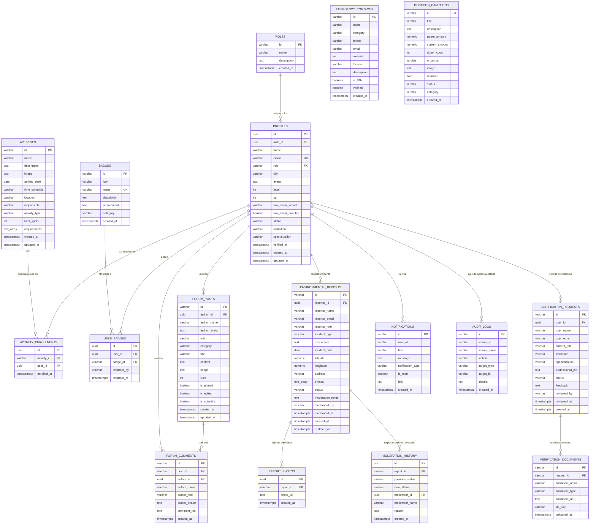

# 🗄️ Diagrama Entidad-Relación (ER) - Base de Datos Supabase (PostgreSQL)
**Universidad Manuela Beltrán — Ingeniería de Software**  
**Sprints 1, 2 y 3 Integrados (Modelo Relacional Completo)**

---

## 1. Diagrama Entidad-Relación (Mermaid ERD)

---

## 2. Diccionario de Datos y Restricciones Principales

| Tabla | Llave Primaria | Llaves Foráneas (FK) | Restricciones Notables |
| :--- | :--- | :--- | :--- |
| `roles` | `id` (VARCHAR) | Ninguna | `name` UNIQUE |
| `profiles` | `id` (UUID) | `role` -> `roles.id`, `auth_id` -> `auth.users.id` | `email` UNIQUE, `level` BETWEEN 1 AND 5, `status` IN ('activo', 'suspendido', 'eliminado') |
| `activities` | `id` (VARCHAR) | Ninguna | `total_spots` >= 1 |
| `activity_enrollments` | `id` (UUID) | `activity_id` -> `activities.id`, `user_id` -> `profiles.id` | UNIQUE(`activity_id`, `user_id`) evita doble inscripción |
| `badges` | `id` (VARCHAR) | Ninguna | `name` UNIQUE |
| `user_badges` | `id` (UUID) | `user_id` -> `profiles.id`, `badge_id` -> `badges.id` | UNIQUE(`user_id`, `badge_id`) evita insignias duplicadas |
| `forum_posts` | `id` (VARCHAR) | `author_id` -> `profiles.id` | `likes` >= 0 |
| `forum_comments` | `id` (VARCHAR) | `post_id` -> `forum_posts.id`, `author_id` -> `profiles.id` | `ON DELETE CASCADE` en eliminación del post padre |
| `environmental_reports` | `id` (VARCHAR) | `reporter_id` -> `profiles.id` | `status` IN ('pendiente', 'aprobado', 'rechazado'), `latitude` [-90, 90], `longitude` [-180, 180] |
| `emergency_contacts` | `id` (VARCHAR) | Ninguna | `category` IN ('lineas_emergencia', 'autoridades_costeras', 'guardia_costera', 'centros_rescate', 'ongs', 'brigadas') |
| `verification_requests` | `id` (VARCHAR) | `user_id` -> `profiles.id` | `status` IN ('pendiente', 'aprobada', 'rechazada') |
| `verification_documents` | `id` (VARCHAR) | `request_id` -> `verification_requests.id` | `ON DELETE CASCADE` |
| `donation_campaigns` | `id` (VARCHAR) | Ninguna | `target_amount` > 0, `current_amount` >= 0 |
| `audit_logs` | `id` (VARCHAR) | Ninguna | Inmutable (sólo operaciones `INSERT`) |
